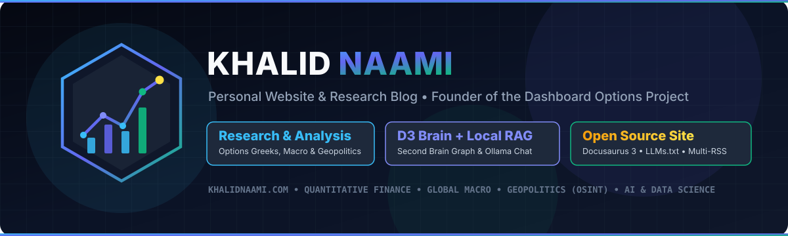
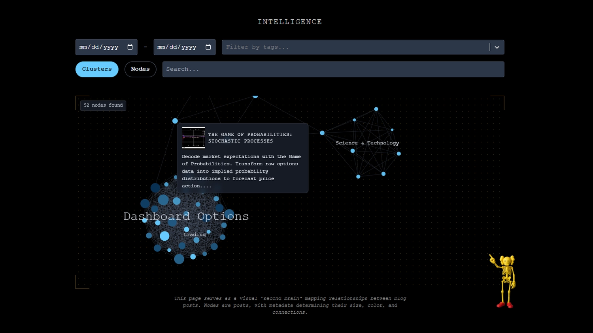
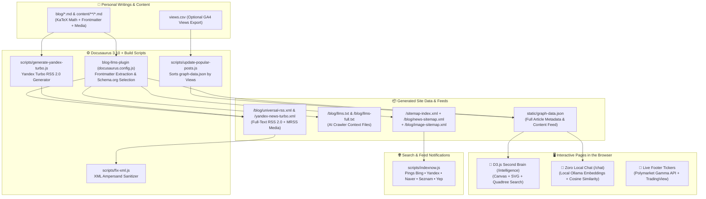

<p align="center">
  
</p>

<h1 align="center">⚡ Khalid Naami — Personal Website &amp; Research Archive</h1>

<p align="center">
  <strong>Open-source code and writings for <a href="https://khalidnaami.com">khalidnaami.com</a> — my personal website where I publish analyses and articles on Quantitative Finance (Options Greeks), Global Macroeconomics, Geopolitics (OSINT), and Artificial Intelligence, complete with a D3.js Knowledge Graph and a local Ollama RAG chat.</strong>
</p>

<p align="center">
  <a href="#-about-this-website--analytical-focus"><b>Analytical Focus</b></a> •
  <a href="#-interactive-features-on-the-site"><b>Site Features</b></a> •
  <a href="#-visual-interface-showcase"><b>Visual Showcase</b></a> •
  <a href="#-site-architecture--publishing-pipeline"><b>Architecture</b></a> •
  <a href="#-content-distribution-rss--search-indexing"><b>Feeds &amp; Indexing</b></a> •
  <a href="#-repository-structure"><b>Structure</b></a> •
  <a href="#-local-development--build-guide"><b>Local Setup</b></a>
</p>

<p align="center">
  <a href="https://khalidnaami.com"></a>
  
  
  
</p>

<p align="center">
  
  
  
  
  <a href="https://x.com/khalidnaami0"></a>
  <a href="https://x.com/DashboardOption"></a>
</p>

---

## ✍️ About This Website & Analytical Focus

**[khalidnaami.com](https://khalidnaami.com)** is the personal website of **Khalid Naami** — Founder of the **Dashboard Options** project.

I use this website primarily to write and share my independent analyses, research essays, and notes across the subjects I study and work on, alongside a few interactive tools I built to help readers explore and query my articles.

### Domains Covered in My Analyses

| Domain | What I Write & Analyze | Core Topics & Methods |
|---|---|---|
| **📈 1. Quantitative Finance & Options Greeks** | Market microstructure, options dealer positioning, **Gamma Exposure (`GEX`)**, `0DTE` flows, and options Greeks (**`Delta`**, **`Gamma`**, **`Vanna`**, **`Charm`**, **`Vomma`**, **`Vega`**). | Black-Scholes-Merton math, volatility dynamics, and analysis using CBOE, OPRA, Deribit & Binance market data. |
| **🌍 2. Global Macroeconomics** | Sovereign debt dynamics, central bank liquidity cycles, FX and bond yield dislocations, commodities, and intermarket relationships. | Macroeconomic indicators, purchasing power parity (`PPP`), fiscal/monetary transmission, and cross-asset analysis. |
| **🛰️ 3. Political Economy & Geopolitics (OSINT)** | Open-source intelligence (`OSINT`) investigations, defense logistics, maritime trade chokepoints, energy corridors, and geopolitical shifts. | Multi-source verification, strategic corridor analysis, and geopolitical risk assessment. |
| **🧠 4. Artificial Intelligence & Data Science** | Practical AI systems, local LLMs, vector embeddings, client-side Retrieval-Augmented Generation (`RAG`), and quantitative data analysis. | Ollama (`llama3.2`, `nomic-embed-text`), cosine similarity retrieval, Python (`Pandas`, `NumPy`, `SciPy`, `Polars`) & TypeScript. |
| **📜 5. Facts, Events & Software Projects** | Historical events, technical walkthroughs of my coding projects, reading lists, and interactive web experiments. | Docusaurus 3, React 18, D3.js v7, HTML5 Canvas, Recharts, Leaflet, and KaTeX mathematical typesetting. |

---

## 🧩 Interactive Features on the Site

| Page / Feature | Route / Location | What It Does |
|---|---|---|
| **📰 Research Blog & Volume Chart** | [`/blog`](https://khalidnaami.com/blog) · [`src/components/Blog/CustomBlogList.tsx`](src/components/Blog/CustomBlogList.tsx) | Filterable article archive with tag chips (`tag:name`), reading-time filter, sector quick-cards, and an interactive Recharts word-volume timeline ([`BlogHistory.tsx`](src/components/BlogHistory.tsx)). |
| **🧠 Second Brain (Intelligence Graph)** | [`/intelligence`](https://khalidnaami.com/intelligence) · [`src/components/Intelligence/`](src/components/Intelligence/) | Interactive **D3.js v7 force-directed graph** linking all of my blog posts by shared tags, sized by word count and shaded by recency, with `d3.quadtree` hover/click inspection. |
| **💻 Zoro AI Terminal (Local Ollama Chat)** | [`/chat`](https://khalidnaami.com/chat) · [`src/pages/chat.tsx`](src/pages/chat.tsx) | Client-side RAG interface that connects directly to **your own local Ollama instance**, embeds my blog posts in your browser from [`/graph-data.json`](static/graph-data.json), and answers questions using only my articles with source links. |
| **📊 Market & Prediction Tapes** | [`src/components/PolymarketTape/`](src/components/PolymarketTape/) · [`src/components/TickerTape.js`](src/components/TickerTape.js) | Footer market ticker displaying live **Polymarket** event odds alongside a **TradingView** tape (`S&P 500`, `Nasdaq 100`, `SPY`, `QQQ`, `Gold`, `Silver`, `WTI Oil`, `BTC`, `ETH`, `NVDA`). |
| **📚 Books, Media, Resume & Travel Map** | [`/books/to-read`](https://khalidnaami.com/books/to-read) · [`/resume/experience`](https://khalidnaami.com/resume/experience) · [`KhalidTravelMap.js`](src/components/home/KhalidTravelMap.js) | Personal reading lists, project showcases, academic/work timeline, and an interactive **React-Leaflet** map of cities I have visited. |
| **🎮 Mini-Game (Mewtwo / Mew vs. Pokéballs)** | [`/game`](https://khalidnaami.com/game) · [`src/components/PokemonGame/PokemonGame.tsx`](src/components/PokemonGame/PokemonGame.tsx) | A fun HTML5 Canvas + Web Audio API arcade mini-game embedded on the site, accompanied by technical blog posts explaining how it was built. |

---

## 🖼️ Visual Interface Showcase

<p align="center">
  
  
</p>

<p align="center">
  <em>Left: <b>Second Brain Graph</b> connecting articles across Quantitative Finance, Geopolitics &amp; Macro. Right: <b>Zoro Chat Terminal</b> running local client-side RAG over my posts via Ollama.</em>
</p>

<p align="center">
  
</p>

<p align="center">
  <em>Sequence diagram showing how the browser-side embedding and Ollama RAG retrieval flow works on <code>/chat</code>.</em>
</p>

---

## 🏗️ Site Architecture & Publishing Pipeline

Whenever the site builds, custom Docusaurus plugins and Node.js scripts process the Markdown articles in `blog/` and `content/` to generate static pages, graph data, AI context files, RSS feeds, and sitemaps:



---

## 🌐 Content Distribution, RSS & Search Indexing

The build pipeline automatically packages my analyses so both human readers and search/AI engines can discover and read them accurately:

1. **`llms.txt` & `llms-full.txt` (`blog-llms-plugin`)**:
   Automatically generates an article index (`/blog/llms.txt`) and a complete Markdown compilation (`/blog/llms-full.txt`) on every build.
2. **Sector-Aware `Schema.org` JSON-LD**:
   Tags in each article's frontmatter automatically assign structured schema types (`ClaimReview` for Fact Check, `AnalysisNewsArticle` for Daily Analysis and Political Economy, `TechArticle` for Dashboard Options and Science & Technology, `NewsArticle` for Global Economy, and `Report` for Facts and Events).
3. **Sitemaps & Multi-Format RSS**:
   Generates `sitemap.xml`, `sitemap-index.xml`, **Google News Sitemap** (`/blog/news-sitemap.xml`), **Image Sitemap** (`/blog/image-sitemap.xml`), **Universal RSS 2.0** (`/blog/universal-rss.xml`), and **Yandex Turbo RSS** (`/yandex-news-turbo.xml`).
4. **Automated `IndexNow` Pings ([`scripts/indexnow.js`](scripts/indexnow.js))**:
   During `postbuild`, all `<loc>` URLs from `build/sitemap.xml` are submitted to **Bing (`api.indexnow.org`)**, **Yandex**, **Naver**, **Seznam**, and **Yep**.

---

## 📂 Repository Structure

```text
khalid-naami.github.io/
├── .github/workflows/
│   └── github-pages.yml              # GitHub Pages automated build & deploy workflow
├── blog/                             # Research articles & analyses (.md)
├── content/                          # Books, Media & Resume pages (.md)
├── scripts/
│   ├── update-popular-posts.js       # Optional GA4 views.csv ranking for static/graph-data.json
│   ├── generate-yandex-turbo.js      # Builds Yandex Turbo RSS 2.0 feed
│   ├── fix-xml.js                    # Fixes unescaped ampersands in RSS/Atom XML
│   ├── indexnow.js                   # Submits sitemap URLs to IndexNow endpoints
│   └── tag_blogs.js                  # Frontmatter tag helper script
├── src/
│   ├── components/
│   │   ├── Blog/                     # CustomBlogList search, tag & reading-time filter
│   │   ├── BlogPokemonGame/          # Interactive visual demos embedded in game blog posts
│   │   ├── CustomFooter/             # Site footer + Polymarket & TradingView ticker tapes
│   │   ├── DesignSystem/             # Reusable UI components (Button, Card, Heading, StatBlock, Tag)
│   │   ├── General/                  # Articles, Books, Courses, Education, Experience, Videos lists
│   │   ├── Intelligence/             # D3.js Second Brain graph (GraphCanvas, GraphContainer, GraphControls)
│   │   ├── PokemonGame/              # HTML5 Canvas + Web Audio API mini-game
│   │   ├── PolymarketTape/           # Live Polymarket odds gauge tape
│   │   ├── Terminal/                 # Zoro terminal UI & source citation preview
│   │   └── home/                     # Homepage sections (WhoAmI, Beliefs, LatestPosts, KhalidTravelMap, Journey)
│   ├── hooks/
│   │   └── useBlogFeed.ts            # Hook to load graph-data.json
│   ├── lib/
│   │   ├── fetchFeed.ts              # Word-count, color-hue interpolation & image extraction
│   │   └── analytics.ts              # Google Tag Manager / gtag event helper
│   ├── pages/
│   │   ├── index.js                  # Homepage
│   │   ├── intelligence.js           # D3.js Second Brain page
│   │   ├── chat.tsx                  # Local Ollama RAG chat page
│   │   ├── game.tsx                  # Mini-game page
│   │   └── privacy.tsx               # Privacy Policy (GDPR, LGPD & COPPA)
│   └── theme/                        # Swizzled Docusaurus theme wrappers
├── static/
│   ├── img/                          # Images, diagrams, banners & assets
│   ├── audio/                        # NotebookLM audio overview & game sound effects
│   ├── graph-data.json               # Generated blog feed used by /intelligence & /chat
│   └── robots.txt                    # Crawler directives & sitemap links
├── docusaurus.config.js              # Docusaurus config, blog-llms-plugin & XML/RSS generators
├── sidebars.js                       # Docs sidebar configuration
└── tailwind.config.js                # Tailwind CSS configuration
```

---

## 📖 Local Development & Build Guide

### Prerequisites
- **Node.js**: `>= 18.0` (Node `20` used in GitHub Actions)
- **Package Manager**: `yarn` (or `npm`)
- **Ollama** *(Optional — only needed if you want to chat with the posts locally on `/chat`)*

### 1. Clone & Install

```bash
git clone https://github.com/khalid-naami/khalid-naami.github.io.git
cd khalid-naami.github.io

yarn install --frozen-lockfile
```

### 2. Run Locally

```bash
yarn start
```
Starts the Docusaurus dev server at `http://localhost:3000` with live reload and KaTeX math rendering.

### 3. Production Build & Feed Generation

```bash
yarn build
```
This runs:
1. `npm run update-posts` (`scripts/update-popular-posts.js`)
2. `docusaurus build` (generates static HTML/JS, `graph-data.json`, `sitemap.xml`, `sitemap-index.xml`, `news-sitemap.xml`, `image-sitemap.xml`, `universal-rss.xml`, `llms.txt`, and `llms-full.txt`)
3. `postbuild` (`generate-yandex-turbo.js`, `fix-xml.js`, and `indexnow.js`)

### 4. Preview Production Build Locally

```bash
yarn serve
```

### 5. Using the Local Ollama Chat (`/chat`)

To ask questions over my articles locally using **Ollama**:

```bash
# 1. Pull a chat model and an embedding model:
ollama pull llama3.2:3b
ollama pull nomic-embed-text

# 2. Enable CORS so the browser can talk to your local Ollama:
# macOS / Linux:
OLLAMA_ORIGINS="https://khalidnaami.com,http://localhost:3000" ollama serve

# Windows (PowerShell as Administrator):
setx OLLAMA_ORIGINS "https://khalidnaami.com" /m
```
Then open [`/chat`](https://khalidnaami.com/chat), click **"Index my blog"**, and query any topic covered in my posts.

---

## 📬 Connect

- **Personal Website**: [https://khalidnaami.com](https://khalidnaami.com)
- **Personal X (Twitter)**: [@khalidnaami0](https://x.com/khalidnaami0)
- **Dashboard Options X**: [@DashboardOption](https://x.com/DashboardOption)
- **LinkedIn**: [Khalid Naami](https://www.linkedin.com/in/khalid-naami-a953263bb/)
- **GitHub**: [github.com/khalid-naami](https://github.com/khalid-naami)
- **Schedule a Call**: [cal.com/khnaami](https://cal.com/khnaami)
- **Email**: `research@khalidnaami.com`

---

<p align="center">
  <sub>Copyright © 2026 <b>Khalid Naami</b> | Personal Website &amp; Research Archive.</sub>
</p>
