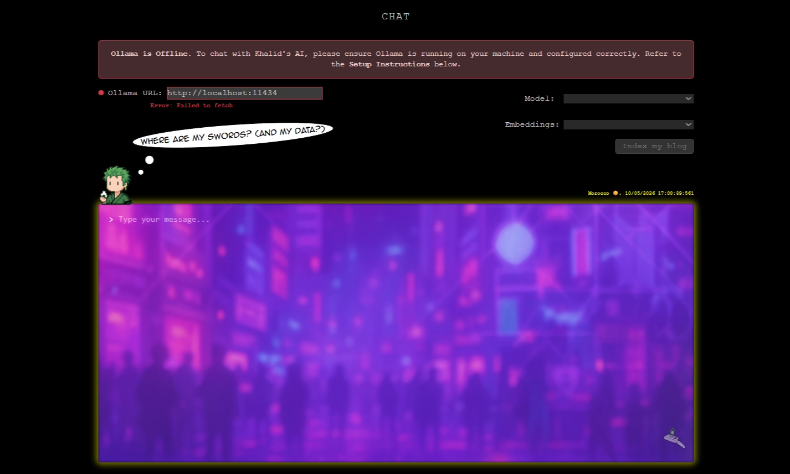
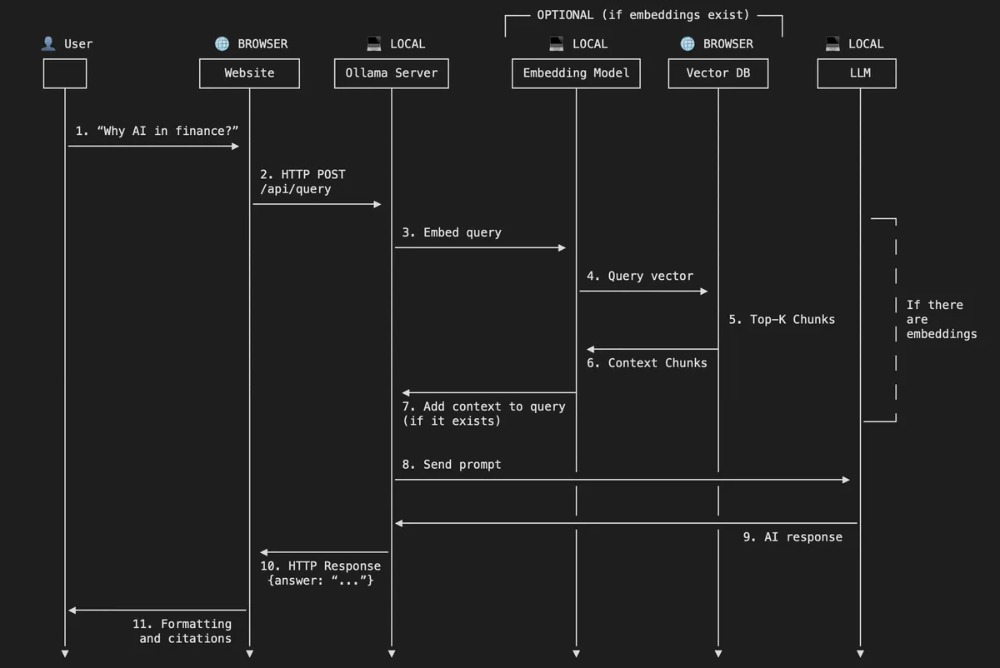
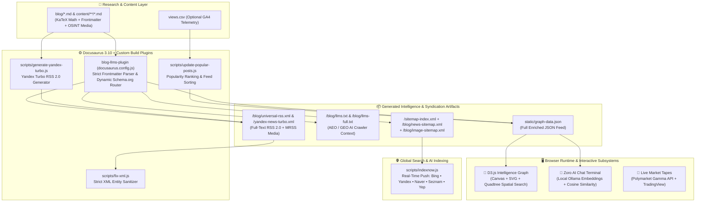

<p align="center">
  
</p>

<h1 align="center">⚡ Khalid Naami — Financial Intelligence &amp; Strategic Research Platform</h1>

<p align="center">
  <strong>Official Open-Source Architecture powering <a href="https://khalidnaami.com">khalidnaami.com</a> — Quantitative Derivatives (Options Greeks &amp; GEX), Geopolitical OSINT, Global Macroeconomics, Interactive D3.js Knowledge Graph &amp; Privacy-First Local RAG AI.</strong>
</p>

<p align="center">
  <a href="#-executive-overview--strategic-domains"><b>Strategic Domains</b></a> •
  <a href="#-key-platform-capabilities--subsystems"><b>Core Subsystems</b></a> •
  <a href="#-visual-interface-showcase"><b>Visual Showcase</b></a> •
  <a href="#-system-architecture--data-pipeline"><b>System Architecture</b></a> •
  <a href="#-aeogeo--multi-engine-syndication-engine"><b>AEO/GEO &amp; Indexing</b></a> •
  <a href="#️-ironwall-advanced-security-posture"><b>IronWall Security</b></a> •
  <a href="#-step-by-step-development--deployment-guide"><b>Developer Guide</b></a>
</p>

<p align="center">
  <a href="https://khalidnaami.com"></a>
  
  
  
</p>

<p align="center">
  
  
  
  
  <a href="https://x.com/khalidnaami0"></a>
  <a href="https://x.com/DashboardOption"></a>
</p>

---

## 🔥 Executive Overview & Strategic Domains

**[khalidnaami.com](https://khalidnaami.com)** is the flagship digital research platform and interactive engineering portfolio of **Khalid Naami** — Founder, Owner & CEO of **Dashboard Options**, Academic Strategic Analyst, Investigative OSINT Researcher, and Quantitative Technologist.

Unlike conventional static blogs, this repository is engineered as a **full-spectrum Financial & Geopolitical Intelligence Platform** combining institutional-grade research publishing, real-time prediction and derivatives market telemetry, an interactive D3.js neural knowledge graph ("Second Brain"), a zero-server local RAG AI assistant (`Zoro Terminal`), and automated Generative Engine Optimization (`AEO`/`GEO`) pipelines.

### The 5 Core Strategic Research Pillars

| Strategic Pillar | Primary Focus & Analytical Scope | Key Methodologies & Data Feeds |
|---|---|---|
| **📈 1. Quantitative Finance & Options Greeks** | Market microstructure, dealer positioning, **Gamma Exposure (`GEX`)**, `0DTE` liquidity flows, and higher-order Greeks (**`Delta`**, **`Gamma`**, **`Vanna`**, **`Charm`**, **`Vomma`**, **`Vega`**). | Black-Scholes-Merton PDEs, volatility surface modeling, CBOE, OPRA, Deribit & Binance derivatives data. |
| **🌍 2. Global Macroeconomics** | Sovereign debt cycles, central bank liquidity regimes, FX & yield-curve dislocations, commodity supercycles, and cross-asset intermarket mechanics. | Institutional macro indicators, purchasing power parity (`PPP`), treasury issuance, and real-rate transmission analysis. |
| **🛰️ 3. Political Economy & Geopolitics (OSINT)** | Investigative open-source intelligence (`OSINT`), defense industrial depletion, maritime chokepoints, energy corridors, and strategic conflict analysis. | Satellite/maritime telemetry, defense logistics verification, and multi-source geopolitical cross-examination. |
| **🧠 4. Artificial Intelligence & Data Science** | Local LLM inference, vector embeddings, client-side Retrieval-Augmented Generation (`RAG`), supervised learning, and quantitative financial forensics. | Cosine-similarity vector stores, Ollama (`llama3.2`, `nomic-embed-text`), Python (`Pandas`, `NumPy`, `SciPy`, `Polars`) & TypeScript. |
| **⚙️ 5. Full-Stack Systems & Security Engineering** | High-performance React/Docusaurus web architecture, automated XML/RSS/JSON syndication, and zero-trust client hardening via **IronWall Advanced Security**. | Docusaurus 3.10, React 18, D3.js v7, Recharts, Leaflet GIS, KaTeX, and locked GitHub Actions CI/CD. |

---

## 🚀 Key Platform Capabilities & Subsystems

| Subsystem | Route / Module | Technical Highlights |
|---|---|---|
| **🧠 Intelligence Graph ("Second Brain")** | [`/intelligence`](https://khalidnaami.com/intelligence) · [`src/components/Intelligence/`](src/components/Intelligence/) | Interactive **D3.js v7 force-directed neural graph** + spatial `d3.quadtree` indexing. Maps semantic tag overlap, article word-count mass, and recency gradients across all research publications at 60 FPS on HTML5 Canvas + SVG. |
| **💻 Zoro AI Terminal (Local Ollama RAG)** | [`/chat`](https://khalidnaami.com/chat) · [`src/pages/chat.tsx`](src/pages/chat.tsx) | **100% privacy-first, client-side RAG engine**. Connects to the user's local **Ollama** instance (direct or via Cloudflare Tunnel), computes embeddings over [`/graph-data.json`](static/graph-data.json), performs in-browser cosine similarity search, and streams contextual answers with verified source citations. |
| **📊 Live Market & Prediction Tapes** | [`src/components/PolymarketTape/`](src/components/PolymarketTape/) · [`src/components/TickerTape.js`](src/components/TickerTape.js) | Dual real-time market telemetry strip: **Polymarket Gamma API** prediction market probability gauges + **TradingView** multi-asset ticker tape (`S&P 500`, `Nasdaq 100`, `Gold`, `WTI Crude`, `BTC`, `ETH`, `NVDA`). |
| **📰 Strategic Blog & Dynamic Schema Engine** | [`/blog`](https://khalidnaami.com/blog) · [`src/components/Blog/CustomBlogList.tsx`](src/components/Blog/CustomBlogList.tsx) | Terminal-styled research explorer with instant multi-tag filtering (`tag:name`), reading-time thresholds, Recharts publication volume histograms ([`BlogHistory.tsx`](src/components/BlogHistory.tsx)), and automatic **JSON-LD Schema.org** classification (`TechArticle`, `AnalysisNewsArticle`, `ClaimReview`, `Report`). |
| **🗺️ Interactive GIS Travel & Operations Map** | [`src/components/home/KhalidTravelMap.js`](src/components/home/KhalidTravelMap.js) | **React-Leaflet + ArcGIS World Topographic** interactive globe with animated `flyTo` camera transitions, SRI-verified stylesheets, and automated SEO `alt`-attribute mutation observers. |
| **🎮 HTML5 Canvas Game Engine (Mewtwo vs. Pokéballs)** | [`/game`](https://khalidnaami.com/game) · [`src/components/PokemonGame/PokemonGame.tsx`](src/components/PokemonGame/PokemonGame.tsx) | Custom 60 FPS HTML5 Canvas arcade engine with Web Audio API synthesizer/buffer decoding, articulated sprite physics, homing/zigzag projectile vectors, and milestone abilities (`Hyper Beam`, `Psystrike`, `Ice Beam`, `Ho-Oh Revival`). |

---

## 🖼️ Visual Interface Showcase

<p align="center">
  
  
</p>

<p align="center">
  <em>Left: <b>Intelligence Graph ("Second Brain")</b> mapping semantic clusters across Quantitative Finance, Geopolitics &amp; Macro. Right: <b>Zoro AI Terminal</b> executing local client-side RAG via Ollama.</em>
</p>

<p align="center">
  
</p>

<p align="center">
  <em>End-to-End Sequence Diagram of the Client-Side Vector Embedding &amp; Retrieval-Augmented Generation (RAG) Pipeline.</em>
</p>

---

## 🏗️ System Architecture & Data Pipeline

During build and post-build execution, custom Docusaurus plugins and Node.js automation scripts transform raw Markdown/MDX research into a unified ecosystem of structured feeds, neural graph nodes, AI context corpora, and search-engine sitemaps:



---

## 🌐 AEO/GEO & Multi-Engine Syndication Engine

This platform is purpose-built for both **traditional search engines (SEO)** and **next-generation AI Answer Engines (`AEO` / `GEO` — ChatGPT, Perplexity, Gemini, Claude, Grok)**:

1. **Native `llms.txt` & `llms-full.txt` Generation (`blog-llms-plugin`)**:
   Every build automatically compiles a structured index (`/blog/llms.txt`) and a complete, concatenated markdown corpus (`/blog/llms-full.txt`) with authoritative biographical and organizational metadata so LLM crawlers ingest exact primary-source context.
2. **Dynamic Sector-Driven `Schema.org` JSON-LD**:
   Articles are automatically classified into specialized `Schema.org` types based on their analytical sector (`ClaimReview` for Fact Checks, `AnalysisNewsArticle` for Daily Analysis & Political Economy, `TechArticle` for Dashboard Options & Science/Tech, `NewsArticle` for Global Economy, and `Report` for Facts & Events).
3. **Multi-Format Sitemaps & Turbo Feeds**:
   Generates standard `sitemap.xml`, `sitemap-index.xml`, **Google News Sitemap** (`/blog/news-sitemap.xml` with Image extensions), **Comprehensive Image Sitemap** (`/blog/image-sitemap.xml`), **Universal RSS 2.0** (`/blog/universal-rss.xml`), and **Yandex Turbo News RSS** (`/yandex-news-turbo.xml`).
4. **Automated `IndexNow` Multi-Engine Push ([`scripts/indexnow.js`](scripts/indexnow.js))**:
   Upon completion of `yarn build`, the `postbuild` pipeline extracts all canonical `<loc>` URLs from `build/sitemap.xml` and broadcasts instant indexing notifications to **Bing (`api.indexnow.org`)**, **Yandex**, **Naver**, **Seznam**, and **Yep**.

---

## 🛡️ IronWall Advanced Security Posture

This repository is continuously audited and hardened using **IronWall Advanced Security (`v1.1`)** across both automated static analysis (`ironwall-scan.cjs`) and deep white-box architectural review:

```json
{
  "engine": "IronWall Advanced Security Scanner v1.1",
  "files_scanned": 544,
  "dependencies_discovered": 1453,
  "findings_count": 0,
  "findings": []
}
```

### Enforced Security Invariants & Controls

| Security Domain | Enforced Control in Codebase | Key Implementation Files |
|---|---|---|
| **Zero Raw HTML Sinks (`CWE-79`)** | All dynamic UI updates use safe React JSX bindings or programmatic DOM nodes (`document.createElement`, `.textContent`, `.replaceChildren`). Zero `dangerouslySetInnerHTML`, `.innerHTML`, or D3 `.html()` sinks. | [`VideosList.tsx`](src/components/General/VideosList.tsx) · [`GraphCanvas.tsx`](src/components/Intelligence/GraphCanvas.tsx) · [`TickerTape.js`](src/components/TickerTape.js) |
| **Strict URL Scheme & Protocol-Relative Guard (`CWE-601`)** | Blocks `javascript:`, `data:`, `vbscript:`, and protocol-relative external redirects (`//evil.com`) across all `window.open`, `<a href>`, `<iframe src>`, and `` sinks. | [`Source.tsx`](src/components/Terminal/Source.tsx) · [`BlogHistory.tsx`](src/components/BlogHistory.tsx) · [`ExperienceList.tsx`](src/components/General/ExperienceList.tsx) |
| **Third-Party API & Image Origin Allowlisting (`CWE-829`)** | Polymarket telemetry enforces a strict `https:` hostname allowlist (`polymarket.com`, `*.polymarket.com`, `polymarket-upload.s3.us-east-2.amazonaws.com`), slug regex validation, payload bounds (`slice(0, 60)`), and `referrerPolicy="no-referrer"`. | [`PolymarketTape/index.js`](src/components/PolymarketTape/index.js) |
| **Local AI / Ollama RAG Hardening (`CWE-918` / `LLM01`)** | Rejects embedded credentials, query strings, and fragments in Ollama URLs; validates `localStorage` vector store schemas (`isValidBlogVector`); sanitizes citation URLs; and isolates untrusted RAG context from system instructions. | [`src/pages/chat.tsx`](src/pages/chat.tsx) |
| **XML/RSS Entity Encoding & Frontmatter Isolation (`CWE-91`)** | All RSS/Sitemap generators escape XML entities (`&lt;`, `&gt;`, `&amp;`, `&quot;`, `&apos;`) and `CDATA` terminators (`]]&gt;`). Frontmatter parsing is strictly scoped to the top `--- ... ---` YAML header block. | [`docusaurus.config.js`](docusaurus.config.js) · [`generate-yandex-turbo.js`](scripts/generate-yandex-turbo.js) · [`fix-xml.js`](scripts/fix-xml.js) |
| **Supply-Chain & CI/CD Lockfile Integrity** | GitHub Actions workflow uses `v4` actions, least-privilege `permissions`, `persist-credentials: false`, `yarn install --frozen-lockfile`, and strict `refs/heads/main` push-only deployment gates. | [`.github/workflows/github-pages.yml`](.github/workflows/github-pages.yml) |

---

## 📂 Repository Structure & Module Map

```text
khalid-naami.github.io/
├── .github/workflows/
│   └── github-pages.yml              # Hardened CI/CD pipeline for GitHub Pages deployment
├── blog/                             # Quantitative Finance, OSINT, Geopolitics & Macro articles (.md)
├── content/                          # Structured documentation pages (Books, Media, Resume)
├── scripts/
│   ├── update-popular-posts.js       # Enriches & sorts static/graph-data.json via GA4 views.csv
│   ├── generate-yandex-turbo.js      # Builds full-text Yandex Turbo RSS 2.0 feed
│   ├── fix-xml.js                    # Post-build XML entity validator & fixer for RSS/Atom feeds
│   ├── indexnow.js                   # Real-time IndexNow broadcaster (Bing, Yandex, Naver, Seznam, Yep)
│   └── tag_blogs.js                  # Bulk frontmatter tag management utility
├── src/
│   ├── components/
│   │   ├── Blog/                     # CustomBlogList terminal filter & sector cards
│   │   ├── BlogPokemonGame/          # Interactive article demos for canvas physics & shaders
│   │   ├── CustomFooter/             # Global footer + Polymarket & TradingView market tapes
│   │   ├── DesignSystem/             # Reusable UI primitives (Button, Card, Heading, StatBlock, Tag)
│   │   ├── General/                  # Articles, Books, Courses, Education, Experience, Videos lists
│   │   ├── Intelligence/             # D3.js Force Graph (GraphCanvas, GraphContainer, GraphControls)
│   │   ├── PokemonGame/              # Full HTML5 Canvas + Web Audio API arcade game engine
│   │   ├── PolymarketTape/           # Live Polymarket Gamma API probability gauge ticker
│   │   ├── Terminal/                 # Interactive Zoro CLI terminal & Source citation tooltips
│   │   └── home/                     # Homepage sections (WhoAmI, Beliefs, LatestPosts, KhalidTravelMap, Journey)
│   ├── hooks/
│   │   └── useBlogFeed.ts            # React hook for asynchronous graph-data.json ingestion
│   ├── lib/
│   │   ├── fetchFeed.ts              # Word-count, recency-hue interpolation & hero image extractor
│   │   └── analytics.ts              # Google Tag Manager / gtag telemetry wrapper
│   ├── pages/
│   │   ├── index.js                  # High-LCP SSR Homepage + GEO structured facts
│   │   ├── intelligence.js           # D3.js Second Brain visualization page
│   │   ├── chat.tsx                  # Local Ollama RAG AI assistant & setup guide
│   │   ├── game.tsx                  # Interactive Mewtwo/Mew Pokéball game page
│   │   └── privacy.tsx               # GDPR, LGPD & COPPA privacy policy
│   └── theme/                        # Swizzled Docusaurus theme wrappers (BlogListPage, BlogPostPage, Layout)
├── static/
│   ├── img/                          # Optimized WebP media, banners, sprites & travel photography
│   ├── audio/                        # NotebookLM RAG podcast & Web Audio game sound effects
│   ├── graph-data.json               # Pre-compiled JSON feed powering the Second Brain & RAG indexer
│   └── robots.txt                    # Crawler directives & sitemap declarations
├── docusaurus.config.js              # Master Docusaurus configuration + blog-llms-plugin + Sitemaps
├── sidebars.js                       # Documentation sidebar hierarchy
└── tailwind.config.js                # Tailwind CSS + Radix design tokens configuration
```

---

## 📖 Step-by-Step Development & Deployment Guide

### Prerequisites
- **Node.js**: `>= 18.0` (Node `20 LTS` recommended, matching CI)
- **Package Manager**: `yarn` (v1) or `npm`
- **Ollama** *(Optional — for testing the `/chat` Local RAG AI assistant)*

### Step 1: Clone & Install Dependencies

```bash
git clone https://github.com/khalid-naami/khalid-naami.github.io.git
cd khalid-naami.github.io

# Install dependencies with strict lockfile enforcement
yarn install --frozen-lockfile
```

### Step 2: Start the Local Development Server

```bash
yarn start
```
Opens `http://localhost:3000` with hot-module replacement (HMR), live KaTeX math rendering, and local `/graph-data.json` generation.

### Step 3: Production Build & Post-Build Syndication Pipeline

```bash
yarn build
```
Running `yarn build` automatically executes the complete multi-stage pipeline:
1. **`npm run update-posts`** (`scripts/update-popular-posts.js`): Updates article rankings in `static/graph-data.json`.
2. **`docusaurus build`**: Compiles static SSR bundles, `sitemap.xml`, `sitemap-index.xml`, `/blog/news-sitemap.xml`, `/blog/image-sitemap.xml`, `/blog/universal-rss.xml`, `/blog/llms.txt`, and `/blog/llms-full.txt`.
3. **`postbuild`**:
   - Runs `scripts/generate-yandex-turbo.js` to generate `build/yandex-news-turbo.xml`.
   - Runs `scripts/fix-xml.js` to sanitize unescaped XML ampersands in `rss.xml` and `atom.xml`.
   - Runs `scripts/indexnow.js` to notify Bing, Yandex, Naver, Seznam, and Yep.

### Step 4: Serve Production Build Locally

```bash
yarn serve
```

### Step 5: Enabling the Local Ollama RAG AI Assistant (`/chat`)

To test the interactive **Zoro AI Terminal** locally with full blog RAG context:

```bash
# 1. Pull a chat model and an embedding model in Ollama:
ollama pull llama3.2:3b
ollama pull nomic-embed-text

# 2. Allow CORS origin for khalidnaami.com (or localhost):
# macOS / Linux:
OLLAMA_ORIGINS="https://khalidnaami.com,http://localhost:3000" ollama serve

# Windows (PowerShell as Administrator):
setx OLLAMA_ORIGINS "https://khalidnaami.com" /m
```
Then navigate to [`/chat`](https://khalidnaami.com/chat), click **"Index my blog"** to generate vector embeddings in your browser, and ask questions about Options Greeks, Gamma Exposure (`GEX`), Geopolitics, or Global Macro.

---

## 📬 Connect & Official Channels

- **Website**: [https://khalidnaami.com](https://khalidnaami.com)
- **Personal X (Twitter)**: [@khalidnaami0](https://x.com/khalidnaami0)
- **Dashboard Options X**: [@DashboardOption](https://x.com/DashboardOption)
- **LinkedIn**: [Khalid Naami](https://www.linkedin.com/in/khalid-naami-a953263bb/)
- **GitHub**: [github.com/khalid-naami](https://github.com/khalid-naami)
- **Schedule a Call**: [cal.com/khnaami](https://cal.com/khnaami)
- **Research Inquiries**: `research@khalidnaami.com`

---

<p align="center">
  <sub>Copyright © 2026 <b>Khalid Naami</b> | Founder &amp; CEO @ Dashboard Options. Hardened with <b>IronWall Advanced Security</b>.</sub>
</p>
