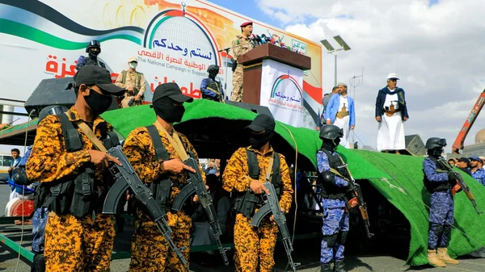

# Oman Mediation: Yanbu Oil Export Drop

The Sultanate of Oman is mediating talks between Houthi and Saudi delegations. The mediation follows maritime intelligence reports indicating a 40 percent drop in crude oil loadings at Saudi Arabia's Yanbu terminal. The export decline, documented by maritime data firms Windward and Vortexa, shows the impact of Houthi maritime blockades on Red Sea shipping lanes.

<!-- truncate -->

---

## Yanbu Export Drop: Crude Loadings Decline by Forty Percent

The Red Sea maritime campaign has targeted Saudi Arabia's western oil terminal:
*   **The Decline**: Crude oil loadings at Yanbu fell by 40 percent since mid-July.
*   **Data Verification**: Maritime intelligence firms Windward and Vortexa verified the drop.
*   **Alternative Routes**: The closure of the Strait of Hormuz has forced reliance on Yanbu.

---

## Oman's Mediation Role: The Dual-Track Diplomatic Channel

Muscat has established a communication link to contain the maritime escalation:
*   **The Channel**: Omani delegations are facilitating talks between Riyadh and Sana'a.
*   **Yemeni Demands**: Houthi representatives demand the lifting of blockades on ports.
*   **Sana'a Airport**: The talks seek the restoration of civilian flights at Sana'a Airport.

---

## Houthi Blockade Policy: Coordinated Maritime Interdiction

Yemeni forces are enforcing a strict blockade policy against regional ports:
*   **Sovereign Right**: Houthi officials state the blockade responds to blockades on Yemen.
*   **Chinese shipping**: Chinese and Japanese vessels are respecting Houthi warnings.
*   **Western Carriers**: Western cargo lines are routing around the Cape of Good Hope.

---

## Houthi Mosquito Fleet: Fast Boat Interdiction Tactics

Yemeni naval units are utilizing light combat craft to monitor shipping lanes:
*   **Mosquito Fleet**: Light combat boats patrol the Bab el-Mandeb strait.
*   **Putin's Praise**: Russian President Vladimir Putin noted the efficiency of Houthi boat tactics.
*   **Radar Avoidance**: The small size of the vessels makes them difficult to track.

---

## Saudi Air Defense Failures: Turkish Drones Face Attrition

The reliance on Turkish-built combat drones has failed to protect airspace:
*   **Akinci Downed**: Yemeni air defenses shot down a Turkish-built Akinci drone over Al-Jawf.
*   **AI Defense Failures**: The loss of the AI-enabled drone shows the limits of Turkey's systems.
*   **Base Vulnerability**: King Khalid Airbase in Khamis Mushait was hit by missile salvos.

---

## Al-Hudaydah Port: Houthi Demands for Immediate Reopening

Negotiators are prioritizing the restoration of logistics terminals:
*   **The Port**: Al-Hudaydah remains a key hub for humanitarian aid.
*   **Import Restrictions**: Houthi officials demand the removal of restrictions on shipping.
*   **Economic Impact**: The normalization of port operations is a requirement for de-escalation.

---

## Suez Shipping Reroutes: Long Detours Around Africa

Maritime transport networks are avoiding the Red Sea corridor:
*   **Cape Route**: Cargo carriers are routing around Africa to reach European ports.
*   **Transit Delays**: Rerouting has increased transit times by 20 to 30 days.
*   **LPG Shipping**: The Japanese carrier *Yasaka* reported delays of over 45 days.

---

## China's Trade Strategy: Navigating the Red Sea Risk

Beijing is coordinating its shipping movements to avoid regional conflict:
*   **New Champion VLCC**: The Hong Kong-flagged tanker altered course in the Gulf of Aden.
*   **COSCO Policy**: The state firm rerouted its car carriers away from the Bab el-Mandeb.
*   **Middle East Policy**: China's actions seek to balance relations with both Riyadh and Sana'a.

---

## Conclusion: The Impact of Maritime Interdiction on Energy Exports

The drop in Yanbu oil exports and the role of Omani mediation show the impact of maritime interdiction on regional energy markets.

By restricting crude loadings and downing strategic drone systems, Houthi forces have challenged Saudi maritime exports. The Omani mediation track and the Cape of Good Hope detours confirm that Red Sea security is linked to political stability in Yemen. As shipping companies adjust their routes, these developments show that energy transit requires diplomatic agreements rather than unilateral enforcement.
---
